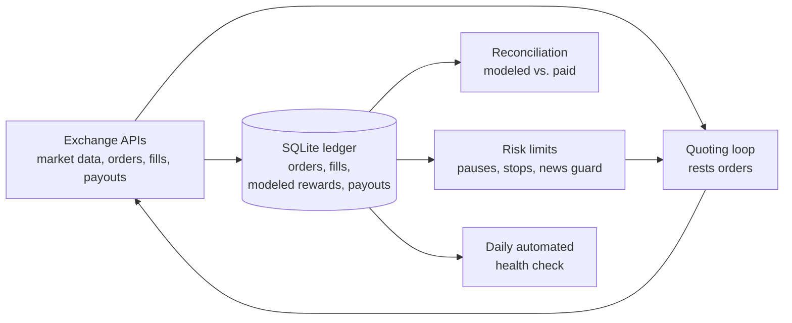

# Prediction-Market Reward Bots

Small, rules-based bots that rest orders on U.S. prediction markets to earn the exchanges' liquidity rewards, plus the ledger and checks that keep their numbers honest.

Live on Kalshi since Sept 24, 2026. All numbers are as of Oct 10, 2026.

> **The code is private.** Kalshi's Liquidity Incentive Program runs until Jan 1, 2027 (unless extended), and publishing the strategy would hand it to competitors. I'm happy to walk through the code in an interview.

## What runs

| Bot | Venue | What it does | Status (Oct 10, 2026) |
|---|---|---|---|
| Kalshi reward bot | Kalshi | Rests orders that qualify for Liquidity Incentive Program rewards | Live since Sept 24 |
| Gemini reward bot | Gemini | Same idea on Gemini's politics reward pools | Live since Oct 1; those pools end Nov 2 |
| Polymarket US bot | Polymarket US | Same idea on sports-futures reward pools | Live |
| Predictions Cup bot | Susquehanna (SIG) student contest, play money | Trades through the contest's API (bots are allowed) | #31 of 1,403; final once every race resolves after Nov 4 |

## How it works

1. Each bot reads market data from the exchange's API and rests orders that qualify for that exchange's liquidity rewards. Which markets and prices it picks stay private.
2. Every order, fill, modeled reward and actual payout goes into a SQLite ledger.
3. The ledger is reconciled against what the exchange actually paid (next section).
4. Risk limits can pause or stop quoting on their own.
5. A daily automated health check reviews each bot, and any release can be rolled back in one step.

## Does the reward model match what the exchange pays?

**Kalshi, the six daily payouts from Oct 4 to Oct 9, 2026:**

| | Amount |
|---|---|
| Kalshi paid | $440.65 |
| The bot estimated | $445.11 |
| Paid ÷ estimated | 0.99 (1% apart) |
| Single daily runs | 0.68× to 1.007× |

- **Why single days miss:** periods booked just above Kalshi's $1 payout minimum sometimes paid $0, so one day can come in low while the total stays close.
- **Before Oct 3:** Kalshi paid early-closed periods in full, so over the bot's whole life Kalshi has paid about $27 more than the bot counted. All of that gap predates Oct 3.

## Model misses, caught and open

- **Gemini (fixed):** on the first Gemini day, the bot's reward estimate was 64× too high. It traced to three model errors, which were fixed and validated on Oct 3. On Oct 4, most pools paid 0.96× to 1.03× the model, with one outlier at 2.28×.
- **Polymarket US (open):** it pays about 0.59× what its model estimates. That model is still off.

## Risk controls

- **Fill-loss pause:** Kalshi quoting stops if fills lose more than $100 in 24 hours (since Oct 3).
- **Loss stops** and a **daily loss tripwire**.
- **News guard:** pulls quotes before scheduled news releases (since Oct 10).
- **Polymarket US:** pauses on a $40 fills drawdown within 24 hours, and on stale data.
- **Daily automated health checks** and **one-step rollbacks**.
- **No new deposits.** Money isn't the constraint.

## What this is, and isn't

- It's **reward income** from posting orders, not a trading-profit strategy. On Kalshi, fills on their own lose money; the liquidity rewards carry the bot.
- The amounts are small, and every number above belongs to one bot on one venue over the stated dates.

## Stack

Python, SQLite and each exchange's REST API, running on a personal Windows laptop. Code written with Claude (Anthropic's AI); I run the bots and make the calls: what goes live, the risk limits, and when to stop.
